# FlowDesk — Architecture

| | |
|---|---|
| **Document status** | Living document |
| **Last updated** | 2026-10-31 |
| **Author** | Abhilash Kuvalkar |
| **Scope** | Application architecture, runtime topology, data, messaging, infrastructure, delivery |
| **Related** | [ADR index](#17-architecture-decision-records) · `docs/adr/` |

---

## Table of contents

1. [Purpose and scope](#1-purpose-and-scope)
2. [System context](#2-system-context)
3. [Architectural drivers](#3-architectural-drivers)
4. [Solution structure](#4-solution-structure)
5. [Service topology](#5-service-topology)
6. [Layering inside the Ticket Service](#6-layering-inside-the-ticket-service)
7. [Domain model](#7-domain-model)
8. [CQRS and the request pipeline](#8-cqrs-and-the-request-pipeline)
9. [Domain events and integration events](#9-domain-events-and-integration-events)
10. [Asynchronous messaging (RabbitMQ and MassTransit)](#10-asynchronous-messaging-rabbitmq-and-masstransit)
11. [Caching (Redis)](#11-caching-redis)
12. [Synchronous service calls (gRPC)](#12-synchronous-service-calls-grpc)
13. [GraphQL BFF](#13-graphql-bff)
14. [Data architecture and multi-tenancy](#14-data-architecture-and-multi-tenancy)
15. [Cross-cutting concerns](#15-cross-cutting-concerns)
16. [Infrastructure and delivery](#16-infrastructure-and-delivery)
17. [Architecture decision records](#17-architecture-decision-records)
18. [Quality attributes](#18-quality-attributes)
19. [Known limitations and future work](#19-known-limitations-and-future-work)
20. [Local development](#20-local-development)
21. [Glossary](#21-glossary)

---

## 1. Purpose and scope

FlowDesk is a multi-tenant B2B support-ticket platform. Companies (tenants) raise
tickets, assign them to agents, track them against SLA policies, and notify agents
when work arrives.

FlowDesk is also a deliberate reference architecture. It exists to demonstrate, in
one coherent codebase, the patterns expected of a senior .NET engineer working on
distributed systems:

- Clean Architecture with CQRS and Domain-Driven Design
- Entity Framework Core for the write model
- Asynchronous messaging with RabbitMQ and MassTransit
- Cache-aside caching with Redis
- Synchronous internal calls with gRPC
- A GraphQL backend-for-frontend
- Infrastructure as Code with both Bicep and Terraform

**In scope:** the three backend services, their shared contracts, the data and
messaging infrastructure they depend on, and how that infrastructure is provisioned.

**Out of scope (for now):** a production front end, authentication and
authorisation, billing, and a production-grade email provider. See
[section 19](#19-known-limitations-and-future-work).

---

## 2. System context

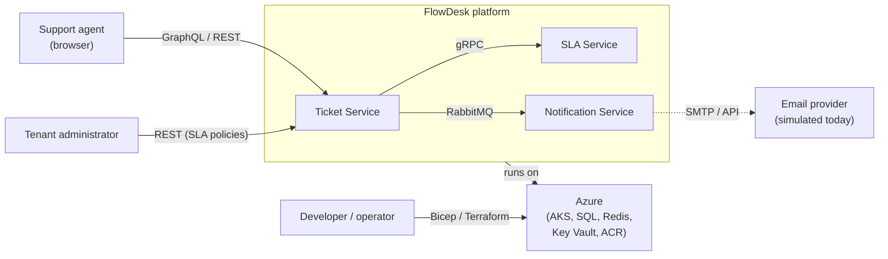

| Actor | Interaction |
|---|---|
| Support agent | Views the dashboard (GraphQL), is notified when a ticket is assigned |
| Tenant administrator | Creates tickets, assigns and resolves them, maintains SLA policies |
| Developer / operator | Provisions infrastructure and deploys services |

---

## 3. Architectural drivers

These are the forces that shaped the design. Each later section traces back to one
or more of them.

| # | Driver | Consequence in the design |
|---|---|---|
| D1 | **Tenant isolation** — one tenant must never see another's data | `TenantId` on every entity, required in every repository method and query |
| D2 | **Core operations must not depend on notifications** | Notifications are asynchronous and decoupled via RabbitMQ (ADR-002) |
| D3 | **Reads and writes have different shapes and frequencies** | CQRS: tracked entities for writes, untracked projections for reads |
| D4 | **Business rules must not be bypassable** | Entities have private setters, factory methods, and behaviour methods |
| D5 | **SLA data is read constantly and changes rarely** | Cache-aside with Redis and explicit invalidation (ADR-003) |
| D6 | **Internal calls are frequent and synchronous** | gRPC with a shared, compiler-enforced contract (ADR-004) |
| D7 | **The front end should fetch exactly what it needs** | GraphQL BFF with field-level resolvers and DataLoaders |
| D8 | **Infrastructure must be reproducible and reviewable** | Bicep and Terraform modules, parameterised per environment |
| D9 | **Application code must be testable without infrastructure** | Interfaces in Domain, implementations in Infrastructure |

---

## 4. Solution structure

```text
FlowDesk/
├── FlowDesk.TicketService/                # API host + application layer (CQRS features)
├── FlowDesk.TicketService.Domain/         # Entities, events, repository and service contracts
├── FlowDesk.TicketService.Infrastructure/ # EF Core, repositories, Redis cache service
├── FlowDesk.SlaService/                   # gRPC server
├── FlowDesk.NotificationService/          # Worker service, RabbitMQ consumers
├── FlowDesk.Contracts/                    # Integration-event message contracts
├── protos/
│   └── sla.proto                              # gRPC contract (shared)
├── infrastructure/
│   ├── bicep/                                 # Azure-native IaC
│   └── terraform/                             # Cloud-agnostic IaC
├── docs/
│   ├── architecture.md
│   └── adr/
├── .github/workflows/                         # CI
├── .azuredevops/                              # Infrastructure pipeline
└── docker-compose.yml                         # Local SQL Server, Redis, RabbitMQ
```

### Project reference rules

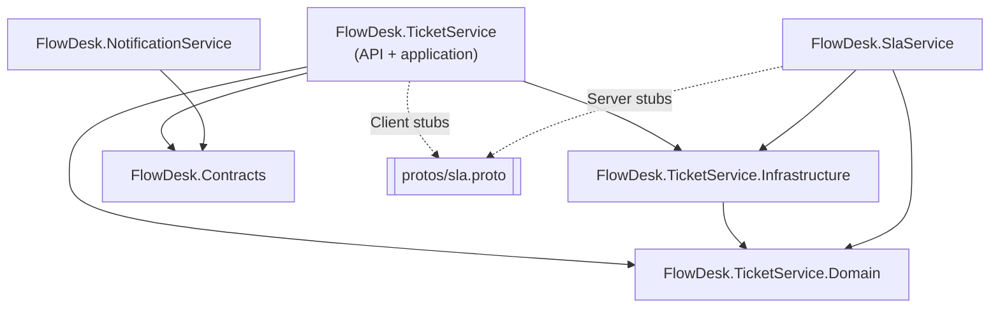

| Rule | Reason |
|---|---|
| `Domain` references nothing | Business rules have no dependency on frameworks or infrastructure |
| `Infrastructure` references `Domain` only | Infrastructure implements Domain contracts; it never the reverse |
| The `.proto` file lives at the solution root | It is the contract between services, owned by neither |
| `FlowDesk.Contracts` holds only primitive-typed message records | Integration events must be stable and serialisable; schema drift becomes a compile error |
| `Infrastructure` does **not** reference `Grpc.Tools` or the proto | Referencing it from both Infrastructure and a service produced duplicate generated types (warning CS0436) |
| The gRPC client implementation lives in `FlowDesk.TicketService` | That is the project that owns the client-side generated code |

### Technology stack

| Concern | Technology | Notes |
|---|---|---|
| Runtime | .NET 10, ASP.NET Core | Minimal APIs |
| ORM | Entity Framework Core 10 | Code-first, `IEntityTypeConfiguration<T>` per entity |
| In-process messaging | MediatR | Commands, queries, notifications, pipeline behaviours |
| Validation | FluentValidation | Run by a MediatR pipeline behaviour |
| Message broker | RabbitMQ | Via MassTransit **8.5.x** (pinned; 9.x requires a commercial licence) |
| Cache | Redis | Via `IDistributedCache` (`Microsoft.Extensions.Caching.StackExchangeRedis`) |
| Internal RPC | gRPC, Protobuf | `Grpc.AspNetCore`, `Grpc.Net.Client`, `Grpc.Tools` |
| GraphQL | Hot Chocolate **16.0.x** | Pinned to 16.0.x |
| Database | SQL Server | One database in the current topology |
| Containers / orchestration | Docker, AKS | |
| IaC | Bicep, Terraform (`azurerm ~> 3.110`) | Remote state in Azure Blob Storage |
| CI/CD | GitHub Actions (build and test), Azure DevOps (infrastructure) | |
| Observability | Application Insights, Log Analytics | Provisioned by IaC |

---

## 5. Service topology

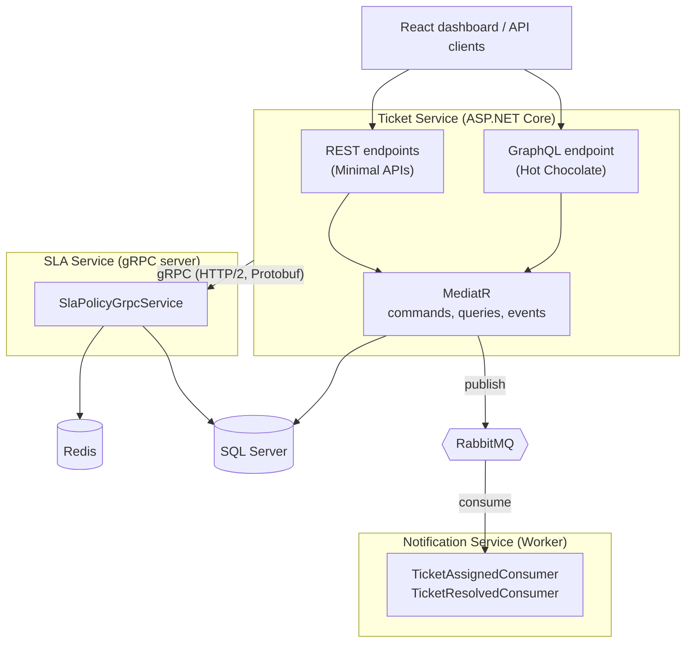

### Service responsibilities

| Service | Type | Owns | Talks to |
|---|---|---|---|
| **Ticket Service** | ASP.NET Core web host | Tickets, agents, comments, ticket lifecycle, the REST and GraphQL surface | SQL Server, SLA Service (gRPC), RabbitMQ (publish) |
| **SLA Service** | ASP.NET Core gRPC host | SLA policy lookup | SQL Server, Redis |
| **Notification Service** | .NET Worker Service | Delivering notifications | RabbitMQ (consume) |

### Communication styles

| Style | Used for | Why |
|---|---|---|
| In-process (MediatR) | Commands, queries, domain events inside one service | Fast, transactional context available, no network |
| Synchronous RPC (gRPC) | Ticket Service → SLA Service policy lookup | The caller cannot proceed without the answer; high frequency |
| Asynchronous messaging (RabbitMQ) | Ticket Service → Notification Service | Fire-and-forget; must not couple core operations to delivery |
| Client-facing (REST, GraphQL) | Browser and API consumers | Human-readable, tooling-friendly, flexible field selection |

---

## 6. Layering inside the Ticket Service

The Ticket Service is split into three projects that follow the dependency rule:
source-code dependencies point inward, towards the Domain.

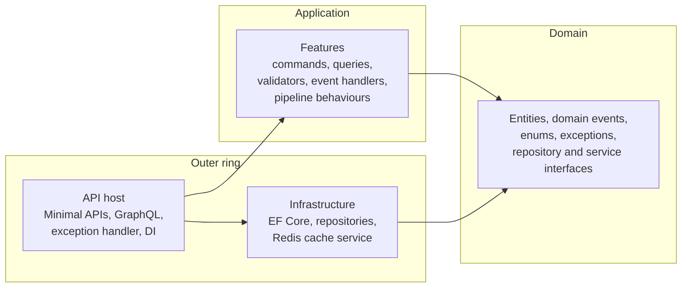

### What lives where

| Layer | Project | Contents |
|---|---|---|
| Domain | `FlowDesk.TicketService.Domain` | `Ticket`, `Agent`, `Comment`, `SlaPolicy`, `BaseEntity`, `IDomainEvent`, domain events, enums, domain exceptions, `ITicketRepository`, `IAgentRepository`, `ISlaPolicyRepository`, `IUnitOfWork`, `ICacheService`, `ISlaServiceClient`, `SlaBreachCalculator` |
| Application | `FlowDesk.TicketService/Features` | One folder per use case (vertical slice): command or query, handler, validator, response DTO |
| Infrastructure | `FlowDesk.TicketService.Infrastructure` | `AppDbContext`, `IEntityTypeConfiguration<T>` classes, migrations, `TicketRepository`, `AgentRepository`, `SlaPolicyRepository`, `RedisCacheService`, `CacheKeys` |
| Host | `FlowDesk.TicketService` | `Program.cs`, `ValidationBehaviour`, `GlobalExceptionHandler`, gRPC client, GraphQL types and resolvers |

### Vertical slices

Features are organised by use case rather than by technical type:

```text
Features/
└── Tickets/
    ├── Commands/
    │   ├── CreateTicket/       command, handler, validator
    │   ├── AssignTicket/
    │   └── ResolveTicket/
    ├── Queries/
    │   ├── GetTicketById/      query, handler, TicketResponse
    │   ├── GetTicketsByStatus/
    │   └── GetSlaStatus/
    └── EventHandlers/          TicketCreated, TicketAssigned, TicketResolved
```

Everything about one use case is in one folder, so a change to "create a ticket"
touches one place.

### Dependency inversion in practice

Command handlers depend on `ITicketRepository` and `IUnitOfWork`, both defined in
the Domain. `AppDbContext` implements `IUnitOfWork`; `TicketRepository` implements
`ITicketRepository`. The handler has no knowledge of EF Core or SQL Server.

```csharp
// Registration — one AppDbContext instance per scope, exposed under two interfaces
builder.Services.AddScoped<ITicketRepository, TicketRepository>();
builder.Services.AddScoped<IAgentRepository, AgentRepository>();
builder.Services.AddScoped<IUnitOfWork>(sp => sp.GetRequiredService<AppDbContext>());
```

`IUnitOfWork` is resolved through the existing `AppDbContext` registration rather
than re-registered as `AddScoped<IUnitOfWork, AppDbContext>()`. The latter would
create a **second, independent** context instance: the repository would track
changes in one context while the unit of work saved an empty one, and nothing
would be persisted.

### Read-side exception

Query handlers use `AppDbContext` directly with `AsNoTracking()` and `Select()`
projections to DTOs, rather than going through `ITicketRepository`. Repositories
return domain entities; a query handler wants projections. Forcing queries through
the repository would materialise full entities only to map and discard most of
their columns. If the read side grows (paging, sorting, complex filters), the
planned step is an `ITicketReadRepository` returning DTOs — see
[section 19](#19-known-limitations-and-future-work).

---

## 7. Domain model

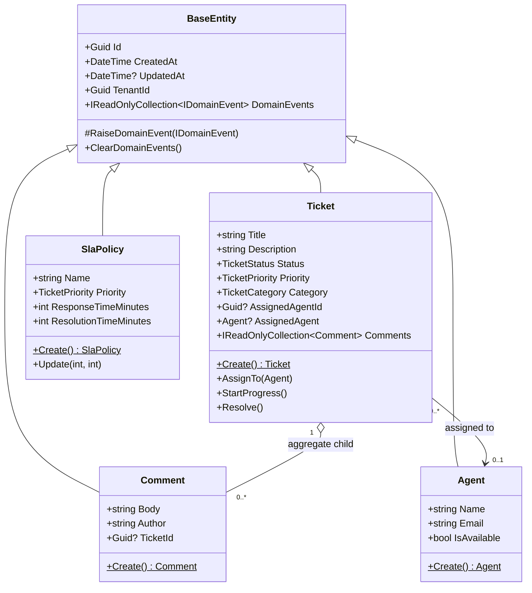

### Aggregates

| Aggregate root | Members | Invariants |
|---|---|---|
| `Ticket` | `Comment` | A comment cannot exist without a ticket; comments are reachable only through `Ticket.Comments` (read-only view); deleting a ticket cascades to its comments |
| `Agent` | — | Email is unique per tenant |
| `SlaPolicy` | — | One policy per priority per tenant; response and resolution times must be greater than zero |

`Ticket` and `Agent` are separate aggregates linked by `AssignedAgentId`. A ticket
holds a reference by identity; deleting an agent sets the ticket's
`AssignedAgentId` to null (`DeleteBehavior.SetNull`) rather than deleting tickets.

### Ticket lifecycle

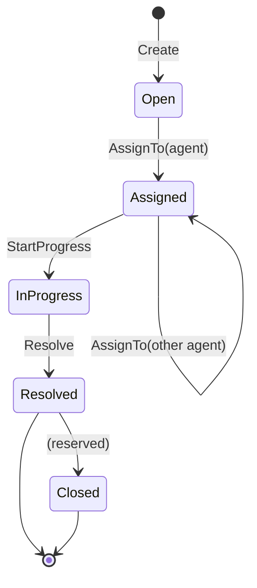

| Transition | Guard | Failure |
|---|---|---|
| `AssignTo` | Status must not be `Resolved` or `Closed` | `InvalidOperationException` → HTTP 409 |
| `StartProgress` | Status must be `Assigned` | `InvalidOperationException` → HTTP 409 |
| `Resolve` | Status must be `InProgress` | `InvalidOperationException` → HTTP 409 |

### Entity design rules

| Rule | Mechanism | Rationale |
|---|---|---|
| State changes only through behaviour | `private set` on all entity properties | Prevents invalid states and skipped transitions |
| Creation only through a factory | `private` parameterless constructor (for EF Core) plus `static Create(...)` | An entity is always born valid |
| Identity assigned in the application | `Guid` generated at construction | Self-identifying before persistence; no cross-database collisions |
| Enums persisted as strings | `HasConversion<string>()` | Reordering or inserting enum members cannot corrupt stored rows |
| Child collections are read-only | Private `List<T>` backing field exposed as `IReadOnlyCollection<T>` | External code cannot mutate the aggregate's internals |
| Time is UTC | `DateTime.UtcNow` | No time-zone ambiguity |

### Domain service

`SlaBreachCalculator` is a stateless domain service. Whether a ticket is breaching
its SLA depends on both a `Ticket` and an `SlaPolicy`; placing it on either entity
would couple two aggregates. It has two overloads — one taking a `Ticket`, one
taking primitive values (`status`, `createdAt`) so GraphQL resolvers working with
`TicketType` can call it without a domain entity.

```text
IsBreaching = ticket is not Resolved
              AND (UtcNow - CreatedAt) in minutes > policy.ResponseTimeMinutes
```

---

## 8. CQRS and the request pipeline

Every operation is exactly one of:

| | Command | Query |
|---|---|---|
| Intent | Change state | Read state |
| Returns | Minimal acknowledgement (`Guid`) or nothing | A response DTO |
| Entity tracking | Tracked (EF Core detects mutations) | `AsNoTracking()` |
| Data access | Via repository + unit of work | `AppDbContext` with `Select()` projection |
| Failure for a missing resource | Domain exception (e.g. `TicketNotFoundException`) | `null` / empty list; the `?` on the return type is the contract |

### Pipeline

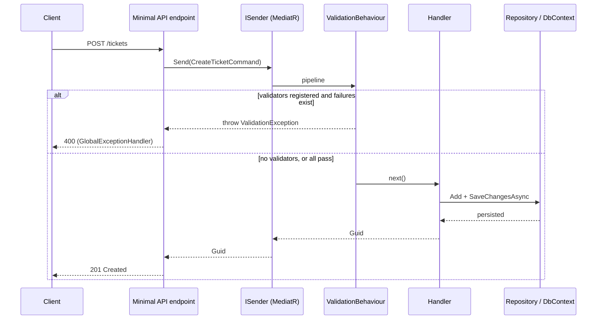

`ValidationBehaviour<TRequest, TResponse>` receives
`IEnumerable<IValidator<TRequest>>`. When no validator is registered for a request
type (most queries), the enumerable is empty and the behaviour calls `next()`
immediately. The pipeline makes no distinction between commands and queries; what
is registered decides what runs.

### Handler conventions

- `Handle` performs the null guard and delegates to a private `DoHandle` that
  contains the asynchronous work.
- Every handler that mutates state calls `IUnitOfWork.SaveChangesAsync`.
  Forgetting it is a silent no-op: the entity is mutated in memory and never
  persisted.
- Handlers fetch tenant-scoped data only: `TenantId` is a parameter of every
  repository lookup.

### Validation layers

| Layer | Responsibility |
|---|---|
| FluentValidation (pipeline) | Shape of the request — required fields, lengths, enum range, positive numbers |
| Domain entity methods | Business invariants — legal state transitions, positive SLA times |

The validator is the first line of defence; the entity is the guarantee. A
handler invoked from somewhere other than the pipeline still cannot violate an
invariant.

---

## 9. Domain events and integration events

FlowDesk distinguishes two kinds of event on purpose.

| | Domain event | Integration event (message) |
|---|---|---|
| Example | `TicketAssignedEvent` | `TicketAssignedMessage` |
| Scope | Inside one service and bounded context | Across service boundaries |
| Transport | MediatR `INotification`, in-process | RabbitMQ via MassTransit |
| Payload | May use domain types | Primitive types only |
| Stability | Free to change with the domain | Public contract — changing it breaks consumers |
| Defined in | `FlowDesk.TicketService.Domain/Events` | `FlowDesk.Contracts/Messages` |

### Raising and dispatching

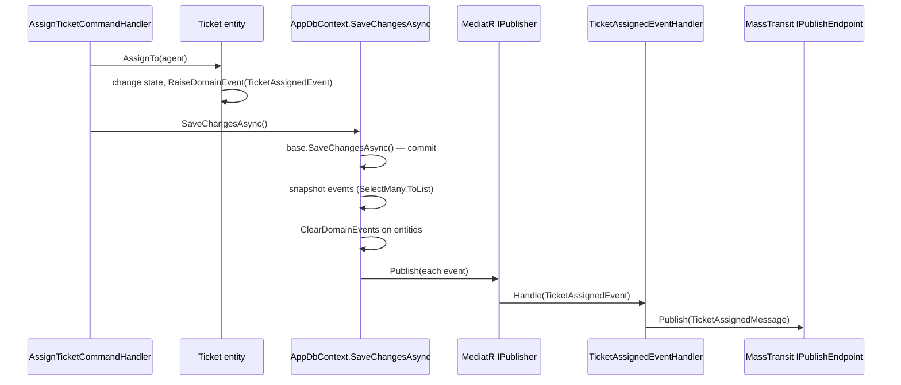

Ordering rules, each of which prevents a specific bug:

| Rule | Prevents |
|---|---|
| Dispatch **after** the database commit | Publishing events about state that never persisted |
| **Snapshot** events into a flat list with `SelectMany(...).ToList()` before clearing | Losing events (the list is a live view over the entity's backing list); also `Select` instead of `SelectMany` yields a list of collections, which MediatR rejects as not an `INotification` |
| **Clear** entity events before publishing | A handler that calls `SaveChangesAsync` re-dispatching the same events indefinitely |
| Use `IPublisher.Publish`, not `ISender.Send` | `Send` requires exactly one handler; domain events need zero-to-many fan-out |

### Open/Closed in practice

Adding a new consequence of "ticket assigned" — an audit entry, an SLA timer — means
registering another `INotificationHandler<TicketAssignedEvent>`. `Ticket` and
`AssignTicketCommandHandler` do not change.

---

## 10. Asynchronous messaging (RabbitMQ and MassTransit)

See **ADR-002**.

### Flow

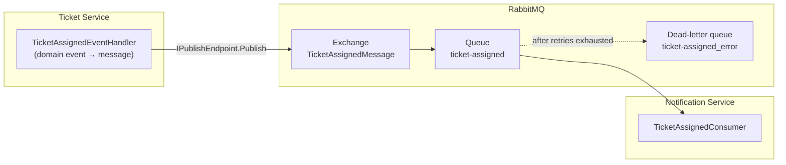

### Contracts

```csharp
public record TicketAssignedMessage(Guid TicketId, Guid AgentId, Guid TenantId, DateTime AssignedAt);
public record TicketResolvedMessage(Guid TicketId, Guid TenantId, DateTime ResolvedAt);
```

Both services reference `FlowDesk.Contracts`. A change to a contract fails the build
in both projects until both are updated.

### Configuration

| Aspect | Setting |
|---|---|
| Transport | RabbitMQ (`rabbitmq://localhost` locally) |
| Topology | `cfg.ConfigureEndpoints(context)` — exchanges, queues and bindings derived by convention from consumer and message types; no hand-written queue names |
| Retry | `UseMessageRetry` with incremental backoff — 3 attempts, 1 s initial interval, +2 s increment |
| Failure handling | After the final retry the message moves to `<queue>_error` for inspection and replay |
| Version | MassTransit **8.3.6**, pinned |

### Failure semantics

| Failure | Behaviour |
|---|---|
| Consumer throws a transient error | Retried with backoff |
| Consumer keeps failing | Message parked in the `_error` queue; operators inspect and replay |
| Notification Service is down | Messages accumulate in the queue and are delivered on recovery; ticket operations are unaffected |
| RabbitMQ is down at publish time | **Not yet covered** — see the outbox note below |

### Outbox (planned)

Today the publish happens after the database commit, in a separate step. If the
process dies between the commit and the publish — or the broker is unreachable —
the message is lost. The remedy is the **transactional outbox**: write the outgoing
message to an outbox table in the same transaction as the business change and let a
background dispatcher publish it. MassTransit provides this for EF Core
(`AddEntityFrameworkOutbox<AppDbContext>` with `UseBusOutbox`). It is described in
the design but not yet wired in — see [section 19](#19-known-limitations-and-future-work).

---

## 11. Caching (Redis)

See **ADR-003**.

### Cache-aside

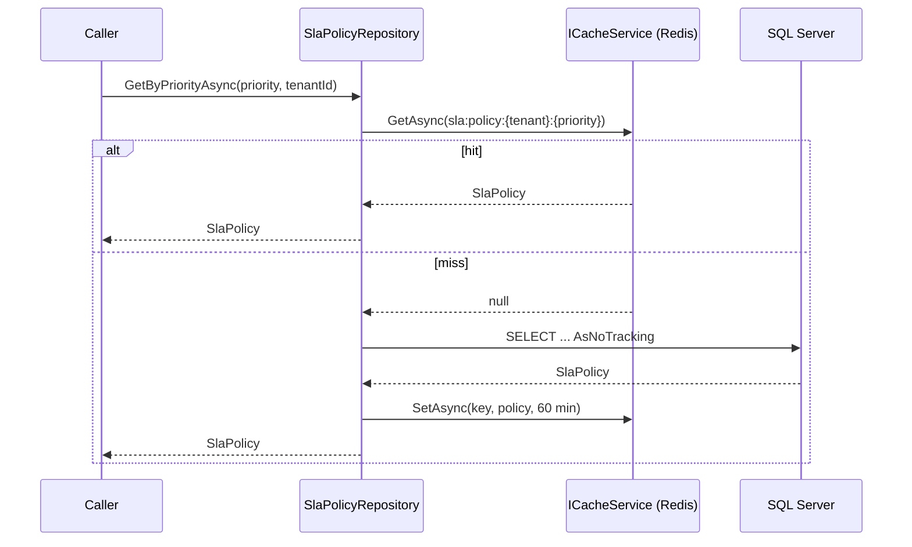

### Design points

| Aspect | Decision |
|---|---|
| Pattern | Cache-aside, owned entirely by the repository; handlers never see `ICacheService` |
| Key format | `sla:policy:{tenantId}:{priority}`, built only by `CacheKeys.SlaPolicy(...)` |
| Instance prefix | `FlowDesk:` (set through `InstanceName`) |
| TTL | 60 minutes absolute |
| Invalidation | After a successful `SaveChangesAsync`, the update handler calls `InvalidateCacheAsync` |
| Abstraction | `ICacheService` (Domain) → `RedisCacheService` (Infrastructure) → `IDistributedCache` |
| Serialisation | System.Text.Json, camelCase |
| Eviction policy (Azure) | `allkeys-lru` |

### Why save, then invalidate

Invalidating **before** saving risks a window in which a concurrent reader misses the
cache, reads the still-old row, and re-caches stale data — and if the save then
fails, the cache holds a value that was never superseded. Saving first and
invalidating second means the cache is only cleared once the new value is durable.
The 60-minute TTL is the backstop if invalidation itself fails.

### Where cache access is allowed

Only repositories call `ICacheService`. A handler that talked to the cache directly
would return `null` on a miss with no database fallback — breaking the pattern.
This rule is intended to be enforced with an architecture test (NetArchTest) so it
fails the build rather than relying on discipline.

---

## 12. Synchronous service calls (gRPC)

See **ADR-004**.

### Contract

`protos/sla.proto` defines `SlaService.GetSlaPolicyByPriority`. The request carries
`tenant_id` and `priority` as strings; the response carries the policy fields plus a
`found` flag.

| Design point | Reason |
|---|---|
| Strings for `tenant_id` and `priority` | Easier to evolve across a service boundary than Protobuf enums |
| `bool found` rather than a null response or `StatusCode.NotFound` | Protobuf messages cannot be null on the wire; a missing policy is an expected outcome, not an exception |
| Field numbers are permanent | Numbers, not names, identify fields in the binary format; reusing one for a different type corrupts data for clients on an older contract |
| `RpcException` with `InvalidArgument` | Malformed `tenant_id` or `priority` is a caller error |

### Code generation

| Project | `GrpcServices` | Generates |
|---|---|---|
| `FlowDesk.SlaService` | `Server` | `SlaService.SlaServiceBase` and message types |
| `FlowDesk.TicketService` | `Client` | `SlaService.SlaServiceClient` and message types |

Generated files land in each project's `obj/Debug/<tfm>/` (`Sla.cs`, `SlaGrpc.cs`).
They are never edited or committed.

### Client side

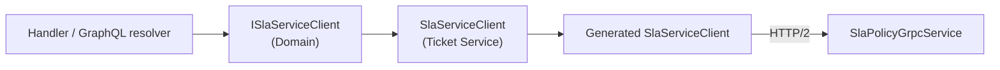

- Handlers and resolvers depend on `ISlaServiceClient` and see only `SlaPolicyDto`.
  Protobuf types and `RpcException` never leak into the application layer.
- The client is registered with `AddGrpcClient`, which uses `IHttpClientFactory`
  for pooled connections and periodic handler rotation. Manually constructed
  `GrpcChannel`s are avoided: they risk socket exhaustion and do not pick up DNS
  changes when a pod is rescheduled in AKS.

### Server side

`SlaPolicyGrpcService` validates input, calls `ISlaPolicyRepository` (which applies
the Redis cache-aside logic), and maps the result to `GetSlaPolicyResponse`. It
listens on HTTP/2 (`http://localhost:5002` in development).

---

## 13. GraphQL BFF

The Ticket Service exposes a Hot Chocolate endpoint (default path `/graphql`, with
the Banana Cake Pop IDE) that serves the agent dashboard in a single request.

### Why GraphQL here

A dashboard screen needs tickets, SLA status per ticket, and the assigned agent.
With REST that is three or more round trips with fixed response shapes. GraphQL lets
the client name exactly the fields it wants.

### Types

GraphQL types (`TicketType`, `AgentType`, `SlaStatusType`, `AgentDashboardType`) are
separate from domain entities. The schema is a public contract that clients
introspect and code-generate against; entity changes must not leak into it.
`TenantId` on `TicketType` and `AgentDashboardType` is marked `[GraphQLIgnore]` — it
is available to server-side resolvers through `[Parent]` but is not exposed to
clients.

### Field-level resolvers

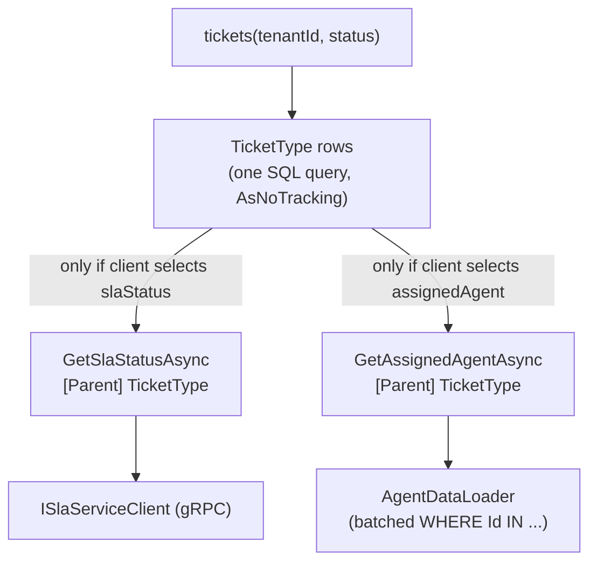

| Concern | Technique |
|---|---|
| SLA lookups only when requested | `slaStatus` is a dedicated resolver; a query selecting `{ id title }` never triggers a gRPC call |
| Agent N+1 | `AgentDataLoader` (`BatchDataLoader<Guid, Agent?>`) collects all requested IDs and issues one `WHERE Id IN (...)` query, using an `IDbContextFactory<AppDbContext>` |
| Repeated gRPC calls for the same priority | In resolvers that loop over tickets, a `Dictionary<TicketPriority, SlaPolicyDto?>` keeps the call count to at most one per priority (four, at most) |
| Service injection | `[Service]` on resolver parameters — resolves from the DI scope per invocation, avoiding captive scoped dependencies in the schema-lifetime query class |
| Filtering and sorting | `AddFiltering()` and `AddSorting()` are registered; applying `[UseFiltering]` and `[UseSorting]` to a resolver returning `IQueryable<T>` lets Hot Chocolate compose client filters into SQL |

### Agent dashboard

`GetAgentDashboardQuery(agentId, tenantId)` loads the agent through the DataLoader
(rejecting an agent that belongs to a different tenant), loads that agent's tickets,
filters to active ones (`Assigned`, `InProgress`), resolves each distinct priority's
SLA policy once, computes `IsBreaching`, and returns the agent with active tickets
and a count of resolved tickets.

---

## 14. Data architecture and multi-tenancy

### Current topology

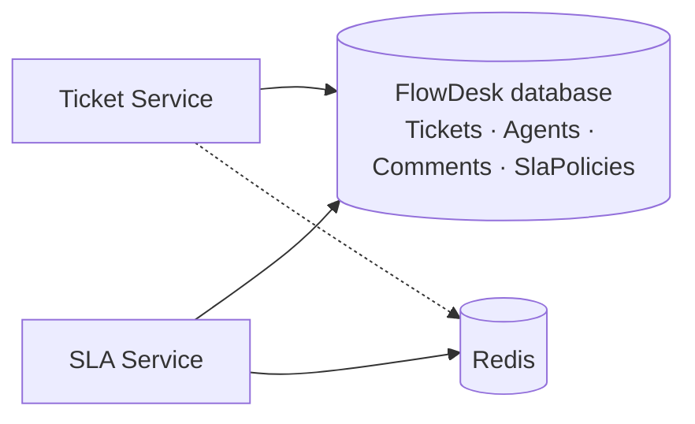

Both the Ticket Service and the SLA Service use the same `AppDbContext` and the same
database. This is a deliberate simplification for the learning project — see
[section 19](#19-known-limitations-and-future-work) for the production path.

### Schema notes

| Table | Notes |
|---|---|
| `Tickets` | Indexes on `TenantId`, `Status`, and `(TenantId, Status)`; status, priority and category stored as strings; FK to `Agents` with `SET NULL` |
| `Agents` | Unique index on `(Email, TenantId)` |
| `Comments` | FK to `Tickets` with `CASCADE` |
| `SlaPolicies` | Unique index on `(TenantId, Priority)` |

Migrations live in `FlowDesk.TicketService.Infrastructure/Persistence/Migrations`.
Because the DbContext project and the startup project differ, `dotnet ef` is run
with both flags:

```bash
dotnet ef migrations add <Name> \
  --project src/FlowDesk.TicketService.Infrastructure \
  --startup-project src/FlowDesk.TicketService \
  --output-dir Persistence/Migrations
```

The startup project must reference `Microsoft.EntityFrameworkCore.Design` directly;
the package is a design-time asset and does not flow transitively.

### Multi-tenancy model

**Shared database, shared schema, row-level isolation by `TenantId`.**

| Control | Where |
|---|---|
| Every entity carries `TenantId` | `BaseEntity` |
| Every repository and query takes `TenantId` and filters by it | Repositories, query handlers, GraphQL resolvers |
| An empty `TenantId` is rejected | FluentValidation on every command and tenant-scoped query |
| Cross-tenant references are rejected | e.g. the agent dashboard returns `null` when the agent's `TenantId` differs from the request |
| Cache keys include `TenantId` | `sla:policy:{tenantId}:{priority}` |

The weak point of this model is that isolation relies on every query remembering the
filter. A missing `TenantId` predicate is a data leak, not a bug that fails loudly.
A global EF Core query filter driven by an ambient tenant context would remove that
class of mistake and is listed under future work.

### Concurrency and lifetimes

| Component | Lifetime | Why |
|---|---|---|
| `AppDbContext` | Scoped | Holds a connection and a non-thread-safe change tracker; one per request |
| Repositories, `IUnitOfWork`, `ICacheService`, `ISlaServiceClient` | Scoped | Share the request's `AppDbContext` |
| gRPC client | Managed by `IHttpClientFactory` | Pooled connections, DNS refresh |
| `IDbContextFactory<AppDbContext>` | Singleton | Used by DataLoaders, which run outside the request's scoped context |

---

## 15. Cross-cutting concerns

### Error handling

A single `IExceptionHandler` (`GlobalExceptionHandler`) maps exceptions to HTTP
responses. The rule is *throw in the domain, catch at the boundary*: entities and
handlers throw typed exceptions and know nothing about HTTP.

| Exception | HTTP status |
|---|---|
| `ValidationException` (FluentValidation) | 400 Bad Request |
| `TicketNotFoundException`, `AgentNotFoundException`, `PolicyNotFoundException` | 404 Not Found |
| `InvalidOperationException` (illegal state transition) | 409 Conflict |
| Anything else | 500 Internal Server Error |

`AddProblemDetails()` is registered as the fallback formatter so unhandled paths
still return structured JSON. `UseStatusCodePages()` is not required: the handler
always writes a body.

Endpoint conventions: a missing single resource is 404; an empty collection is
200 with an empty list.

### Logging and observability

| Aspect | Approach |
|---|---|
| Structured logging | `ILogger<T>` with message templates; placeholder order must match argument order |
| Operational log points | Event handlers log the ticket, tenant, and relevant timestamps; the publish handler logs intent before and confirmation after publishing, so a missing second line identifies a failed publish |
| Telemetry sink | Application Insights, workspace-based on a Log Analytics workspace (provisioned by Bicep and Terraform) |
| Secrets for telemetry | Connection string and instrumentation key stored as Key Vault secrets |

### Security

| Area | Current state |
|---|---|
| Secrets | Held in Azure Key Vault; the AKS kubelet identity has the *Key Vault Secrets User* role; no credentials in Kubernetes secrets |
| Identities | `SystemAssigned` managed identity for AKS; ACR admin user disabled |
| Transport | TLS 1.2 minimum on SQL and Redis; Redis non-SSL port disabled |
| IaC secrets | `@secure()` in Bicep, `sensitive = true` in Terraform; values supplied via pipeline variable groups or `TF_VAR_*` environment variables; `terraform.tfvars` is git-ignored |
| Authentication and authorisation | **Not implemented** — see [section 19](#19-known-limitations-and-future-work) |

### Resilience

| Mechanism | Scope |
|---|---|
| Message retry with incremental backoff, dead-letter queue | Notification consumers |
| Cache TTL as a backstop for failed invalidation | SLA policy cache |
| `found` flag rather than exceptions for expected absence | gRPC contract |
| Per-request deduplication of SLA lookups | GraphQL resolvers |

---

## 16. Infrastructure and delivery

### Azure resources

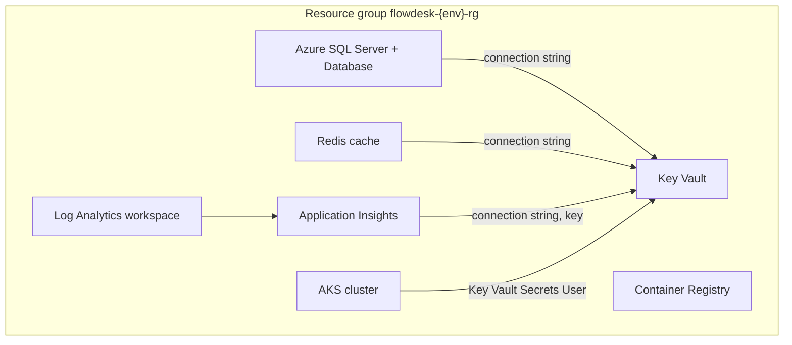

| Resource | Notes |
|---|---|
| Azure SQL | Basic tier in dev; firewall rule `0.0.0.0–0.0.0.0` means *Allow Azure services* (scope tighter for production) |
| Redis | Currently `azurerm_redis_cache` / `Microsoft.Cache/redis`. **Azure Cache for Redis is being retired in favour of Azure Managed Redis** — migration is on the future-work list |
| Key Vault | RBAC authorisation, soft delete enabled |
| AKS | `SystemAssigned` identity, `standard` load balancer SKU, 1 node in dev and 3 in prod |
| ACR | Basic SKU, admin user disabled |
| Monitoring | Log Analytics workspace; Application Insights linked through `WorkspaceResourceId` (workspace-based, not classic) |

### Two IaC implementations

The same environment is described twice, deliberately.

| | Bicep | Terraform |
|---|---|---|
| Location | `infrastructure/bicep` | `infrastructure/terraform` |
| Structure | `main.bicep` orchestrating modules, per-environment `.bicepparam` files | Root module plus `modules/{sql,redis,acr,monitoring,keyvault,aks}` |
| State | Managed by Azure Resource Manager | Remote, in Azure Blob Storage with blob-lease locking; one state key per environment (e.g. `flowdesk-dev.tfstate`) |
| Preview before apply | `az deployment group what-if` | `terraform plan` |
| Secrets | `@secure()`, `readEnvironmentVariable` | `sensitive = true`, `TF_VAR_*` |
| Guard rails | Linting in pipeline | `prevent_destroy = true` recommended on SQL, Redis, Key Vault, Log Analytics in production; provider pinned with `~> 3.110` |

Choice guidance: Bicep for an Azure-only team that wants no state file to manage;
Terraform when multiple providers are involved or the organisation already standardises
on it.

### Dependency order (both tools)

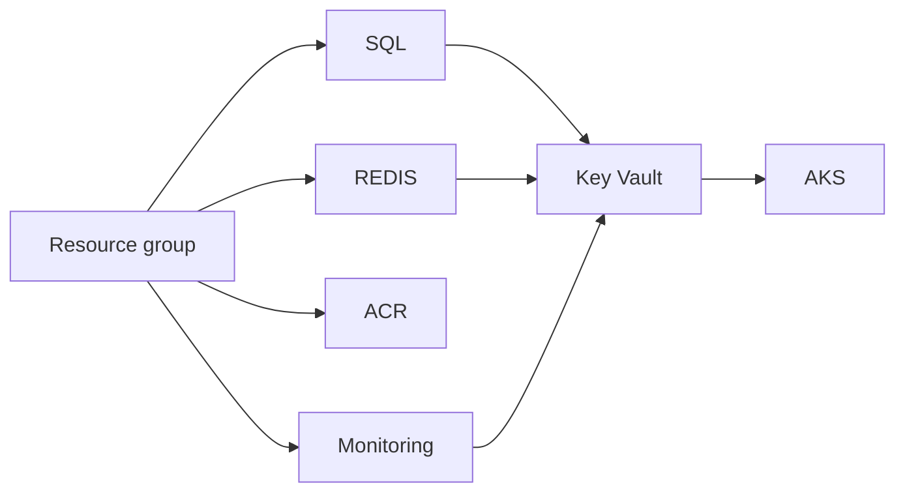

In Terraform the AKS module also carries an explicit `depends_on = [module.keyvault]`
because its role assignment looks the vault up by name through a data source, which
Terraform cannot trace back to the vault module's own role assignments.

### Pipelines

| Pipeline | Platform | Triggers on | Does |
|---|---|---|---|
| Build and test | GitHub Actions (`.github/workflows/ci.yml`) | Push to `main`/`develop`, pull requests | Restore, build, test, publish results; `az bicep lint`; `terraform init -backend=false` and `terraform validate` |
| Infrastructure | Azure DevOps (`.azuredevops/deploy-infrastructure.yml`) | Changes under `infrastructure/**` | Validate, plan or what-if, then apply behind an environment approval for prod |
| Application deployment | Azure DevOps (separate pipeline) | Changes under `src/**`, excluding `infrastructure/**` | Planned — build images, push to ACR, deploy to AKS |

Azure DevOps reads the GitHub repository through a GitHub service connection; no
second repository is needed. Path filters keep the infrastructure and application
pipelines from triggering each other.

### Files that must not be committed

`.terraform/`, `*.tfstate*`, `terraform.tfvars`, plan files, and generated gRPC
sources. `.terraform.lock.hcl` **is** committed, after locking for all target
platforms:

```bash
terraform providers lock -platform=windows_amd64 -platform=linux_amd64 -platform=darwin_amd64
```

---

## 17. Architecture decision records

| ADR | Title | Summary |
|---|---|---|
| [ADR-001](adr/ADR-001-cqrs-over-service-pattern.md)  | CQRS with MediatR over a traditional service layer | Separate read and write models; pipeline behaviours for cross-cutting concerns |
| [ADR-002](adr/ADR-002-rabbitmq-over-direct-http.md) | RabbitMQ over direct HTTP | Decouple ticket operations from notification delivery; retry and dead-letter |
| [ADR-003](adr/ADR-003-redis-cache-aside-pattern.md) | Redis cache-aside for SLA policies | Cache owned by the repository, explicit invalidation, 60-minute TTL |
| [ADR-004](adr/ADR-004-grpc-for-internal-communication.md) | gRPC for internal communication | Contract-first, binary, strongly typed Ticket → SLA calls |

Further decisions worth recording as ADRs: repository and unit of work over
injecting `AppDbContext` into handlers; shared database during the learning phase;
Bicep and Terraform side by side; domain events kept distinct from integration
events.

---

## 18. Quality attributes

| Attribute | How it is addressed | Evidence |
|---|---|---|
| **Maintainability** | Vertical slices; one reason to change per class; Open/Closed via event handlers | New behaviour added by adding handlers, not editing existing code |
| **Testability** | Domain interfaces, constructor injection, no `AppDbContext` in command handlers | A command handler is tested with two substituted interfaces, no database |
| **Modifiability** | Infrastructure behind Domain interfaces; message and gRPC contracts isolated | Swapping the cache or ORM changes one project |
| **Performance** | Untracked projections on reads; cache-aside for hot data; binary RPC; GraphQL resolves only requested fields; batched lookups | N+1 addressed at EF Core and GraphQL layers |
| **Availability** | Async messaging isolates ticket operations from notification outages | Queue buffers while consumers are down |
| **Security** | Tenant scoping, secrets in Key Vault, managed identities, TLS minimums | See [section 15](#15-cross-cutting-concerns) |
| **Operability** | Reproducible IaC, plan/what-if before apply, workspace-based telemetry, dead-letter queue visibility | |
| **Evolvability of contracts** | Shared contracts project; permanent Protobuf field numbers; domain events separate from messages | Schema drift fails the build |

---

## 19. Known limitations and future work

These are stated plainly so the document does not overstate what is built.

| # | Area | Current state | Intended direction | Priority |
|---|---|---|---|---|
| 1 | **Transactional outbox** | Publish happens after commit, in a separate step; a crash or broker outage in between loses the message | `AddEntityFrameworkOutbox<AppDbContext>` with `UseBusOutbox` | High |
| 2 | **Automated tests** | Not yet written | xUnit + NSubstitute handler and domain tests; NetArchTest rule forbidding handlers from depending on `ICacheService` | High |
| 3 | **Shared database and DbContext** | Ticket and SLA services share one `AppDbContext` and database; the SLA Service can reach `Tickets` and `Agents` it does not own | Separate `DbContext` and schema per service, or extract an SLA-specific context | Medium |
| 4 | **`AppDbContext` coupling to MediatR** | `AppDbContext` takes an `IPublisher` to dispatch domain events, so any host that uses it must register MediatR (the SLA Service included) | Move event dispatch into a `SaveChanges` interceptor or the unit of work, keeping the context free of MediatR | Medium |
| 5 | **Tenant isolation by convention** | Every query must remember its `TenantId` predicate | EF Core global query filter fed by an ambient tenant context | Medium |
| 6 | **Authentication and authorisation** | None | JWT bearer with tenant claim; policy-based authorisation; tenant resolved from the token rather than request parameters | High |
| 7 | **Read-side abstraction** | Query handlers use `AppDbContext` directly | `ITicketReadRepository` returning DTOs as read complexity grows | Low |
| 8 | **Redis service** | Azure Cache for Redis, which is being retired | Azure Managed Redis in Bicep and Terraform | Medium |
| 9 | **GraphQL resolver completeness** | Filtering/sorting registered but not applied; some resolvers still resolve SLA eagerly | Apply `[UseFiltering]`/`[UseSorting]` on `IQueryable<T>`; split into field resolvers throughout | Medium |
| 10 | **Notification delivery** | Consumers simulate work | Real provider behind an `IEmailService` abstraction | Medium |
| 11 | **Background jobs** | Hangfire is in the target stack but not yet wired | Scheduled SLA-breach scans with a Redis distributed lock to prevent duplicate runs | Low |
| 12 | **Application deployment pipeline** | Only the infrastructure pipeline exists | Build and push images to ACR; deploy manifests or Helm charts to AKS | Medium |
| 13 | **Front end** | Banana Cake Pop and API explorers only | React + TypeScript with Apollo Client on the existing GraphQL schema | Low |
| 14 | **SQL network exposure** | `Allow Azure services` rule | Private endpoints or per-AKS outbound IP rules | Medium (before production) |

---

## 20. Local development

### Prerequisites

Docker Desktop, .NET 10 SDK, Azure CLI (only for infrastructure work), Terraform (only
for infrastructure work).

### Dependencies

`docker-compose.yml` starts SQL Server, Redis, and RabbitMQ. Individually:

```bash
docker run -d -p 6379:6379 --name flowdesk-redis redis:alpine
docker run -d --name flowdesk-rabbitmq -p 5672:5672 -p 15672:15672 rabbitmq:3-management-alpine
```

### Services

| Service | Command | Default endpoint |
|---|---|---|
| Ticket Service | `dotnet run --project src/FlowDesk.TicketService` | REST and `/graphql` on the configured Kestrel port |
| SLA Service | `dotnet run --project src/FlowDesk.SlaService` | gRPC on `http://localhost:5002` (HTTP/2) |
| Notification Service | `dotnet run --project src/FlowDesk.NotificationService` | Background consumer; no HTTP surface |

### Configuration keys

| Key | Used by | Example |
|---|---|---|
| `ConnectionStrings:DefaultConnection` | Ticket, SLA | `Server=localhost;Database=FlowDesk_Dev;Trusted_Connection=True;TrustServerCertificate=True;` |
| `ConnectionStrings:Redis` | Ticket, SLA | `localhost:6379` |
| `ConnectionStrings:RabbitMQ` | Ticket, Notification | `rabbitmq://localhost` |
| `GrpcServices:SlaService` | Ticket | `http://localhost:5002` |

### Useful URLs

| What | URL |
|---|---|
| GraphQL IDE | `https://localhost:{port}/graphql` |
| RabbitMQ management | `http://localhost:15672` (guest / guest) |

---

## 21. Glossary

| Term | Meaning |
|---|---|
| **Aggregate root** | The single entry point to a cluster of related objects; external code reaches children only through it |
| **BFF** | Backend for Frontend — an API shaped for one client's needs |
| **Cache-aside** | The application checks the cache, falls back to the source on a miss, and populates the cache |
| **CQRS** | Command Query Responsibility Segregation — separate models for changing and reading state |
| **DataLoader** | Batches many keyed lookups made during one request into a single query |
| **Dead-letter queue** | Holds messages that failed all retries, for inspection and replay |
| **Domain event** | A fact raised by an entity, handled in-process |
| **Integration event** | A message published across a service boundary |
| **Outbox pattern** | Writing outgoing messages to a table in the same transaction as the business change, then publishing them from there |
| **Protobuf** | Binary serialisation format used by gRPC; fields are identified by number |
| **Unit of Work** | A boundary around a set of changes that are persisted together |
| **Vertical slice** | Organising code by use case rather than by technical layer |
